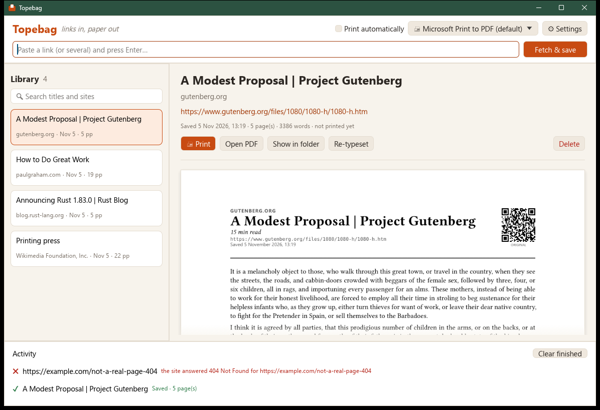
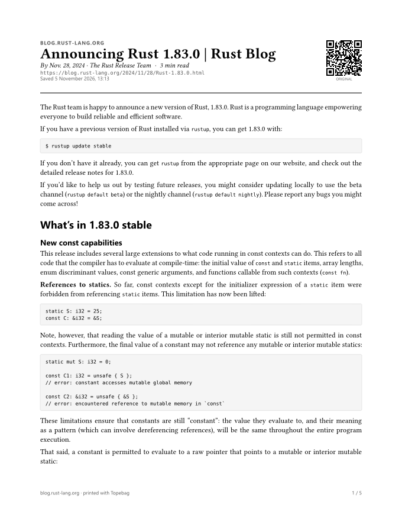
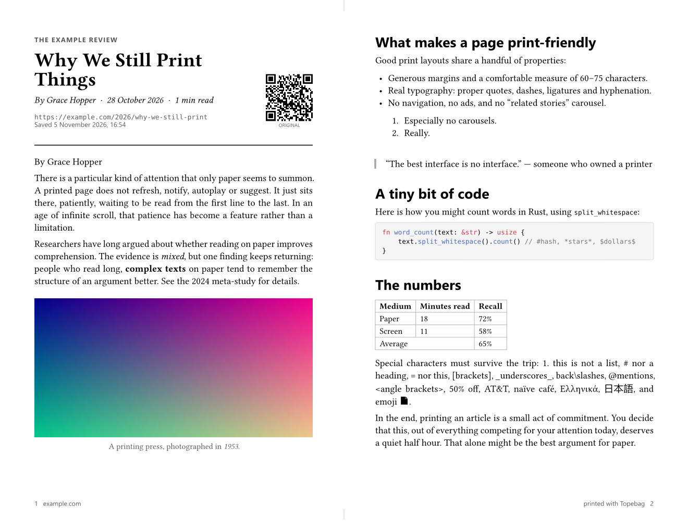

# Topebag

**Links in, paper out.** Paste a link to an article or a PDF. Topebag strips
away the navigation, ads and cookie banners, typesets the content as a
clean, print-friendly PDF, sends it straight to your printer, and keeps a
copy in its library. It can also print your **Instapaper queue**.

Topebag is a native desktop app written in Rust. Everything runs locally: no
cloud service, and no PDF reader is required to print.



<p align="center"></p>

---

## Features

- **Paste and print.** Paste one link or a whole list (Ctrl+V works anywhere
  in the window). Each link is fetched, cleaned and printed in the background.
- **Reader-mode extraction.** Uses a Rust port of Mozilla Readability (the
  engine behind Firefox Reader View) to find the actual article. Pages that
  aren't articles fall back to a cleaned-up copy of the whole page.
- **PDF links.** Links that are already PDFs (papers, reports) are stored
  untouched and printed page by page.
- **JavaScript-heavy pages.** When a plain download comes back (nearly)
  empty, or a site refuses non-browser clients, Topebag reloads the page in
  Microsoft Edge without a window and uses the rendered result.
- **Paywalled and logged-in sites.** Sign in once in Topebag's *own* browser
  profile. Sites you list are then fetched with your subscription. Your
  everyday browser's passwords and cookies are never read.
- **Your Instapaper queue.** Connect the private RSS feed of your Instapaper
  Unread folder to see unprinted saves and print them in one click, or have
  new saves printed automatically.
- **Typeset like a book.** The embedded [Typst](https://typst.app) compiler
  lays out the pages: justified text with hyphenation, smart quotes, headings,
  lists, tables, highlighted code, quotes, and captioned figures that float to
  avoid half-empty pages.
- **Two pages side by side.** Optionally print each sheet as a landscape
  spread of two half-size pages, like an open book. Topebag then tightens
  type and spacing *just enough* to use the fewest sheets (never below
  8.5 pt). A short article fits on a single sheet, and long reads take about
  half the paper.
- **A print-friendly masthead.** Site, title, byline, date, reading time, the
  source URL and a **QR code** back to the original. Page headers and footers
  carry the title and page numbers.
- **Direct printing.** Topebag prints through the standard Windows print
  system, so any installed printer works. You choose the printer, copies and
  quality.
- **A library.** Every document is saved with its PDF, images and metadata.
  **Tag** documents, **search their full text**, rename them, preview,
  reprint, or **re-typeset** with new settings (paper, font, columns) without
  downloading again.
- **Lives in the tray.** Closing the window keeps Topebag running in the
  system tray (to accept links and watch Instapaper). It can start with
  Windows, and launching it again just brings the window back.
- **Fully local and inspectable.** Each document is a plain folder on disk,
  with no database to break.
- **A CLI as well.** `topebag add <url>`, `topebag instapaper --print-all`,
  `topebag search …` and more.

## Quick start (Windows)

### 1. Prerequisites

| Requirement | How to get it |
|---|---|
| Rust (stable, MSVC toolchain) | `winget install Rustlang.Rustup` |
| MSVC C++ build tools and Windows SDK | Visual Studio Installer, then the **"Desktop development with C++"** workload |
| Microsoft Edge (optional) | Preinstalled on Windows 10/11. Only needed for JavaScript-heavy and signed-in sites. Chrome works too. |

Topebag is mostly pure Rust, but one dependency of Typst (`stacker`)
compiles a few lines of C, and Rust needs the Windows SDK to link.

### 2. Build and run

```bash
cargo run --release
```

The first build compiles several hundred crates and takes a few minutes.
Later builds take seconds. The executable is at
`target/release/topebag.exe`, and you can copy it anywhere because fonts and
the template are compiled in.

> **Tip:** `cargo test` runs the test suite: unit tests plus offline
> end-to-end tests of the whole pipeline (articles, PDFs, JavaScript pages,
> Instapaper feeds, search) against a local web server.

## Using Topebag

1. **Copy a link** from your browser.
2. **Press Ctrl+V** anywhere in the Topebag window, or paste into the bar at
   the top. Paste several links at once to queue them all.
3. The **Activity** panel shows progress: downloading, loading in the browser
   if needed, finding the article, fetching images, typesetting, printing.
4. The document appears in the **Library** with a live page preview.

| Control | What it does |
|---|---|
| **Print automatically** | When on, new documents are printed as soon as they're typeset. When off, they're only saved. |
| **▮ One page / ▮▮ Side by side** | Switch new documents between normal pages and two-pages-per-sheet spreads. |
| **Printer menu** | Pick a printer, or "System default". Use *Refresh list* after adding a printer. |
| **Instapaper** | Your Instapaper queue (the button shows how many saves are unprinted). |
| **Print** (Ctrl+P) | Print the selected document again. |
| **✎** next to the title | Rename the document. |
| **+ add tag** | Tag the document (comma-separate several). Click a tag to remove it. |
| **Open PDF / Show in folder** | Open the saved PDF in your viewer, or reveal it in Explorer. |
| **Re-typeset** | Rebuild the selected article with your *current* settings. |
| **Settings** (Ctrl+,) | Everything below. |

### Searching the library

The search box looks at titles, sites, bylines, tags **and the full text** of
every saved article, and shows a snippet of where the words were found.

| Query | Finds |
|---|---|
| `gutenberg press` | documents containing both words |
| `"infinite scroll"` | the exact phrase |
| `tag:long-reads` | documents tagged *long reads* (the tag chips under the search box do the same) |
| `rust -async` | documents with *rust* but not *async* |

### Printing your Instapaper queue

1. On instapaper.com, open **Unread**, open the **Downloads** menu (top
   right), and copy the **RSS Feed** link.
2. In Topebag, click **Instapaper**, paste the link and click **Connect**.
3. Your unprinted saves are listed. Tick the ones you want and click
   **Fetch & print**, or **Skip** them.
4. Optionally turn on **Print new saves automatically**. Topebag checks every
   15 minutes (configurable) while it's running, including from the tray.
   Only articles saved *after* you turn this on are printed automatically, so
   a big backlog never floods your printer.

Printed and skipped items never come back. No password or API key is
involved, but the feed link is a secret, so keep it private. Any RSS or Atom
feed works the same way.

### Paywalled and logged-in sites

1. In **Settings → JavaScript pages and sign-ins**, list the sites you
   subscribe to (one per line, such as `nytimes.com`).
2. Click **Open sign-in browser…**, sign in to those sites in the Edge window
   that opens, then **close that window**.
3. Links from those sites are now loaded in that browser profile, with your
   subscription.

From the command line: `topebag sign-in https://www.nytimes.com/` adds the
site and opens the sign-in window.

### Side-by-side spreads

Turn on **▮▮ Side by side** in the toolbar (or *Settings → Page layout →
Spread*). Each landscape sheet then holds two half-size pages: the masthead
starts the left page, text flows down the left page and continues on the
right, each half has its own page number, and a small mark shows the fold.



With **Tighten spacing to use the fewest sheets** (on by default), Topebag
lays the article out at normal spacing and at its most compact. If compact
saves sheets, it searches for the *least* tightening that keeps that sheet
count. The document details show the result, for example "3 sheets, side by
side (spacing tightened 81%)".

| Article | Normal pages | Side by side, fitted |
|---|---|---|
| A 14-minute newsletter piece with 8 images | 7 pages | 4 sheets |
| Paul Graham, *How to Do Great Work* | 19 pages | 8 sheets |
| A 146-page Rust tutorial | 146 pages | 57 sheets |

As spacing tightens, paragraphs switch from blank-line gaps to book-style
first-line indents, and figures and margins shrink with the text. Printing
turns each landscape sheet a quarter turn automatically, so it fills portrait
paper. To convert a saved article, select it and click **Re-typeset** (or
`topebag retypeset --side-by-side <id>`).

### Settings

| Setting | Default | Notes |
|---|---|---|
| Print automatically | on | |
| Copies | 1 | |
| Quality | Standard (300 dpi) | High (600 dpi) gives crisper text on laser printers and uses about 4× the memory per page. |
| Paper | from your Windows region | US Letter, A4, US Legal, A5 |
| Typeface | Serif (Libertinus) | Sans-serif uses Segoe UI. |
| Text size | 11 pt | 8–16 pt |
| Columns | One | Two columns save paper on long reads. Not used with side-by-side spreads. |
| Spread: two pages side by side | off | Landscape sheets with two half-size pages each. |
| Spread: tighten spacing to use the fewest sheets | on | Shrinks text (to 8.5 pt at most), spacing, margins and figures only as much as needed. |
| Justify with hyphenation | on | |
| Include images / grayscale | on / off | Grayscale saves colour ink. |
| Links | Plain text | *Footnote with URL* prints every external link's address as a footnote. |
| QR code | on | Links back to the original page. |
| Use the browser | Automatic | *Always* loads every page in Edge (slower). *Never* disables it. |
| Sites you've signed in to | — | Always loaded with Topebag's browser profile. |
| Instapaper feed / print automatically / interval | — / off / 15 min | |
| Keep running in the tray | on | Closing the window hides Topebag. Quit from the tray menu. |
| Start with Windows | off | Adds Topebag to your per-user startup list (Task Manager → Startup apps). |

Settings are stored in `settings.json` in the data folder (see below).

### The tray icon

While Topebag runs, its icon sits in the notification area. **Click** it to
open the window. **Right-click** for: *Print link from clipboard*, *Check
Instapaper now*, *Quit Topebag*. Starting Topebag again (or running
`topebag gui <url>`) hands everything to the running copy.

## Command line

The same executable has a CLI. Run `topebag --help` for details.

```bash
topebag add https://example.com/article            # fetch, save, and print (if auto-print is on)
topebag add https://example.com/report.pdf         # PDFs work too
topebag add --no-print URL1 URL2                   # just save
topebag add --side-by-side URL                     # two pages per sheet, fitted to the fewest sheets
topebag add URL --printer "Brother HL-L2305 series Printer"
topebag add URL --print-to-file out.pdf            # paper-free test via "Microsoft Print to PDF"
topebag list                                       # library, newest first
topebag search "gutenberg press" tag:history       # full-text search
topebag tag <id> +reading -todo                    # add/remove tags
topebag print <id>                                 # reprint a saved document
topebag retypeset <id>                             # rebuild with current settings
topebag retypeset --side-by-side <id>              # convert a saved article to spreads
topebag instapaper --feed <RSS URL>                # connect Instapaper
topebag instapaper                                 # list unprinted saves
topebag instapaper --print-all                     # fetch and print them
topebag instapaper --skip-all                      # mark them all as handled
topebag sign-in https://www.nytimes.com/           # sign in to a site in Topebag's browser
topebag printers                                   # installed printers
topebag info                                       # data folder and settings
topebag gui [--background] [URL…]                  # open the app (or hand links to the running one)
```

## Where your data lives

```
%LOCALAPPDATA%\Topebag\
  settings.json
  instapaper.json     which queue items were printed or skipped
  instance.json       how a second launch finds the running app
  browser-profile\    Topebag's own Edge profile (your site sign-ins)
  library\
    2026-11-05_143012_the-quiet-joy-of-paper\
      entry.json      title, URL, dates, tags, print history, image list
      article.html    the cleaned article (kept for re-typesetting)
      article.txt     plain text (for full-text search)
      main.typ        the generated Typst source
      img\…           downloaded images, normalised for print
      qr.svg          QR code
      document.pdf    the print-ready PDF (for PDF links: the original file)
```

Set the `TOPEBAG_HOME` environment variable to use a different folder, which
is handy for a demo library or for tests. Back up, sync or delete entries
with ordinary file tools.

## How it works

```
URL ─► fetch ─┬─► extract ─► convert ─► typeset ─► PDF ─► print
              │     ▲          │           │                │
              │  Edge headless images     Typst          Win32 GDI
              │  (JS / sign-in)           (embedded)     (or CUPS `lp`)
              └─► PDF link ─────────────► Typst wrapper ───┘
```

See **[docs/ARCHITECTURE.md](docs/ARCHITECTURE.md)** for the module map,
design decisions and how to extend Topebag. The API docs build with
`cargo doc --open`.

## Troubleshooting

| Problem | Fix |
|---|---|
| `LNK1104: cannot open file '…build_script_build….exe'` | The project path is too long for the MSVC linker (260-character limit). Move the project to a shorter path, or set `CARGO_TARGET_DIR=C:\tb-target`. |
| `LNK1104: cannot open file 'msvcrt.lib'` or `cl.exe` can't find `windows.h` / `vcruntime.h` | The MSVC C++ tools are incomplete. Install the **Desktop development with C++** workload. |
| Printing opens a "Save Print Output As" dialog | Your selected or default printer is *Microsoft Print to PDF*. Pick your real printer in the printer menu. |
| The default printer keeps changing | Windows' *Let Windows manage my default printer* makes the last-used printer the default. Turn it off in **Settings → Bluetooth & devices → Printers & scanners**, or choose a printer in Topebag explicitly. |
| "The browser returned an empty page — is the sign-in window still open?" | Close the Topebag sign-in browser window. Edge can't use a profile that's already open. |
| A page still comes out nearly empty | Check that **Use the browser** isn't *Never* and that Edge is installed. Some sites block automated browsers too. |
| A paywalled article is cut off | Add the site under *Sites you've signed in to* and sign in with **Open sign-in browser…**. |
| Closing the window doesn't quit | That's *Keep running in the tray*. Quit from the tray icon's menu, or turn the setting off. |
| Instapaper says "not its RSS feed" | Copy the **RSS Feed** link from the Downloads menu, not the page address. |

## Project layout

```
src/
  lib.rs          crate docs and module list
  fetch.rs        HTTP client, charset decoding, meta-refresh, PDF detection
  browser.rs      headless Edge/Chrome and the sign-in profile
  extract.rs      Readability extraction and metadata
  images.rs       image download, normalisation and caching
  convert.rs      HTML → Typst markup (escaping, structure)
  typeset.rs      embedded Typst compiler, fonts, PDF/raster output, PDF wrapper
  library.rs      on-disk library (entries, tags, plain text)
  pipeline.rs     add / print / re-typeset / preview workflows
  instapaper.rs   reading-queue feeds and their state
  search.rs       full-text search and query syntax
  instance.rs     single running instance and hand-off
  autostart.rs    "Start with Windows"
  settings.rs     preferences
  print/          Windows GDI printing; CUPS on macOS/Linux
  main.rs, cli.rs executable entry point and CLI
  gui/            egui desktop app (window, worker threads, tray, theme)
assets/topebag.typ   the document template (all typography lives here)
tests/               end-to-end tests with a local HTTP server
examples/            render_pages: export an entry's pages as PNGs
```

## Status and roadmap

Done: articles, PDF links, JavaScript pages, sign-in sites, the Instapaper
queue, tags, full-text search, tray icon, start with Windows, side-by-side
spreads fitted to the fewest sheets.

Possible next steps:

- Archive items in Instapaper after printing (needs Instapaper's full API and
  a developer key)
- Text extraction from PDFs, so PDF links are full-text searchable too
- Booklet imposition (fold a stack of spreads into a booklet) and duplex printing
- Combining several articles into one "digest" print with a table of
  contents

## License

MIT
